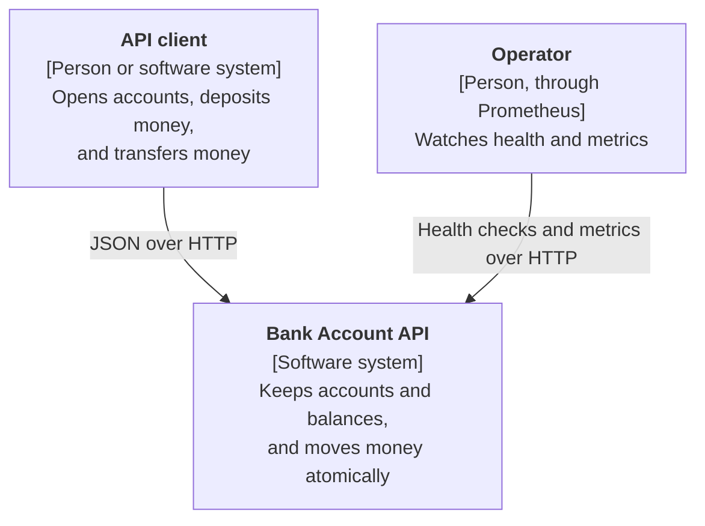
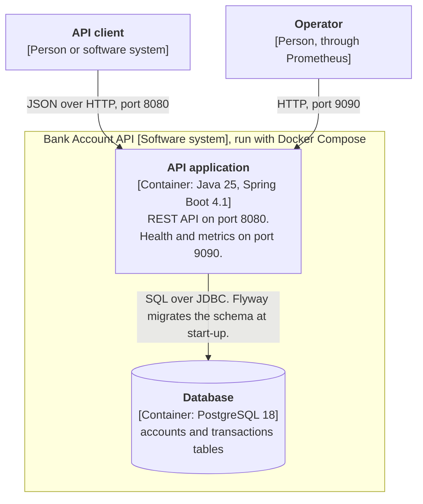
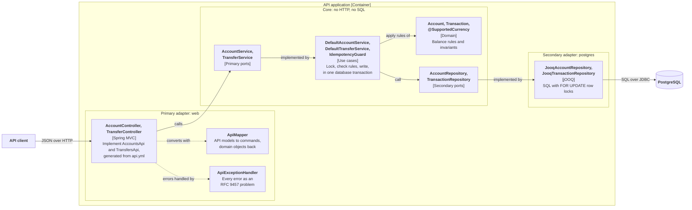
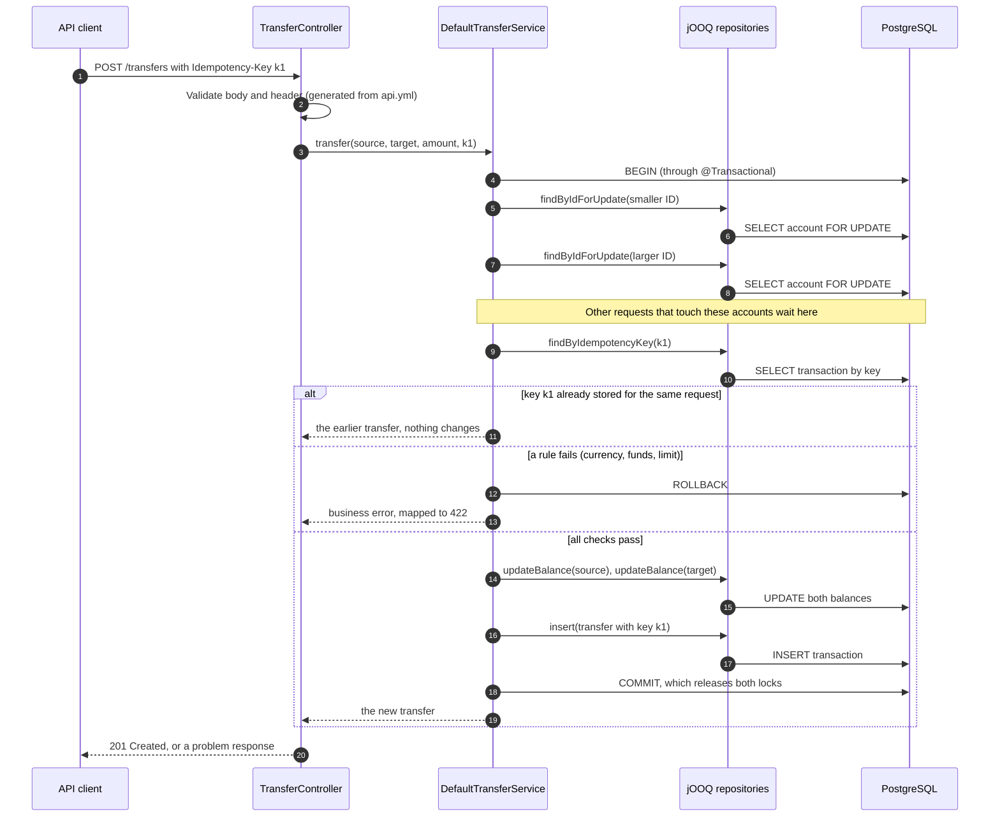

# Bank Account API: architecture

How the service is built. What it must do is in [requirements.md](requirements.md), and why it is
built this way is in the [decision records](decisions/README.md).

The diagrams follow the [C4 model](https://c4model.com): system context, then containers, then
components. They are drawn as Mermaid flowcharts in C4 style, because GitHub renders those
reliably. A sequence diagram then shows one transfer moving through the components.

## Hexagonal architecture

The code uses a hexagonal layout, also called ports and adapters
([decision 11](decisions/11-hexagonal-architecture.md)).

- **The core** holds the business rules: the domain models (`Account`, `Transaction`) and the use
  cases (`DefaultAccountService`, `DefaultTransferService`). It knows nothing about HTTP or SQL.
- **Ports** are interfaces that the core owns.
  - *Primary* (driving) ports are what the outside world calls: `AccountService`, `TransferService`.
  - *Secondary* (driven) ports are what the core needs from the outside: `AccountRepository`,
    `TransactionRepository`.
- **Adapters** connect a port to a technology.
  - The *primary* adapter is the REST API. Its controllers call the primary ports.
  - The *secondary* adapter is PostgreSQL. Its jOOQ repositories implement the secondary ports.

Dependencies always point toward the core: adapters use the core, never the other way round. The
two kinds of adapters never use each other. `ArchitectureTest` (ArchUnit) fails the build if any of
this changes. The core may use the Bean Validation API to define constraints such as
`@SupportedCurrency`, but not its implementation, nor any web, JDBC, jOOQ, or Jackson code.

## Level 1: System context



The service calls no other systems.

## Level 2: Containers



The database has no published port. Only the API container can reach it
([decision 15](decisions/15-docker-only-local-setup.md)).

## Level 3: Components

The components inside the API application, grouped by the three rings of the hexagon.



## A transfer, step by step

One transfer through the components above. Why it is safe under concurrent requests is in
[decision 06](decisions/06-consistency-under-concurrent-requests.md) and
[decision 07](decisions/07-isolation-level-read-committed.md).



## Code layout

```
src/main/java/com/sumup/bankaccount/
├── core/                        business rules, no HTTP or SQL
│   ├── models/                  Account, Transaction, commands
│   ├── exceptions/              one sealed class per business error
│   ├── validation/              @SupportedCurrency, the constraint for currency text in requests
│   ├── ports/primary/           AccountService, TransferService: what the API calls
│   ├── ports/secondary/         AccountRepository, TransactionRepository: what the core needs
│   └── services/                the use cases, with locking and idempotency
└── adapters/
    ├── primary/web/             controllers, ApiMapper, error mapping
    └── secondary/postgres/      jOOQ repositories
src/main/resources/static/api.yml  OpenAPI contract: generates the API interfaces and models
src/main/resources/db/migration/   Flyway schema, with CHECK constraints
jooq-generated/                    jOOQ table classes generated from the schema (committed)
```

### Where each term lives

Code paths are relative to `src/main/java/com/sumup/bankaccount/`. The terms are defined in
[requirements.md](requirements.md#terms).

| Term | Code | API | Storage |
|---|---|---|---|
| Account | `Account` in `core/models/`, `AccountService` in `core/ports/primary/`, `AccountRepository` in `core/ports/secondary/` | `/accounts`, `accountId`, `AccountResponse` | table `accounts` |
| Owner name | `Account.ownerName` | `ownerName` | `accounts.owner_name` |
| Currency | `java.util.Currency`. Which currencies are allowed: `Account.supportsCurrency`. Checking request text: the `@SupportedCurrency` constraint in `core/validation/` | `currency` | `currency` columns, `CHAR(3)` |
| Balance | `Account.balance` (`long`) | `balance` | `accounts.balance` (`BIGINT`) |
| Amount | `long amount` in commands and `Transaction` | `amount`, `initialBalance` | `transactions.amount` (`BIGINT`) |
| Transaction | `Transaction`, `TransactionType` in `core/models/`, `TransactionRepository` in `core/ports/secondary/` | `TransactionResponse` | table `transactions` |
| Deposit | `TransactionType.DEPOSIT`, `DepositCommand`, `AccountService.deposit` | `POST /accounts/{accountId}/deposits`, `DepositRequest`, `"type": "DEPOSIT"` | `type = 'DEPOSIT'` |
| Transfer | `TransactionType.TRANSFER`, `TransferCommand`, `TransferService` in `core/ports/primary/` | `POST /transfers`, `TransferRequest`, `"type": "TRANSFER"` | `type = 'TRANSFER'` |
| Source and target account | `Transaction.sourceAccountId`, `Transaction.targetAccountId` | `sourceAccountId`, `targetAccountId` | `source_account_id`, `target_account_id` |
| Idempotency key | `idempotencyKey` in commands and `Transaction`, `IdempotencyGuard` in `core/services/` | header `Idempotency-Key` | `transactions.idempotency_key` (unique) |
| Ledger | `TransactionRepository` | not exposed yet | table `transactions` |

### Generated code

Never edit generated code by hand. There are two kinds:

| What | Generated from | Where | When |
|---|---|---|---|
| API interfaces (`AccountsApi`, `TransfersApi`) and models (`AccountResponse`, `TransactionResponse`, the request models) | `src/main/resources/static/api.yml` | `build/generated/openapi/` (not committed) | On every build |
| jOOQ table classes (`ACCOUNTS`, `TRANSACTIONS`, and their records) | The schema in `src/main/resources/db/migration/` | `jooq-generated/` (committed) | When you run `make jooq` |

To change the database schema:

1. Add a migration, `src/main/resources/db/migration/V<next>__<description>.sql`.
2. Run `make jooq`. It starts a throwaway PostgreSQL, applies the migrations, and regenerates
   `jooq-generated/`. It runs Gradle on this machine, so it needs JDK 17 or newer.
3. Commit the migration and the generated classes together. CI fails if they do not match.

## Storage

Flyway creates the schema when the service starts, from `src/main/resources/db/migration/`. jOOQ
generates type-safe table classes from that schema
([decision 13](decisions/13-postgresql-flyway-and-jooq.md)). The `CHECK` constraints repeat the
business rules, so the database rejects bad data even if the code has a bug
([decision 06](decisions/06-consistency-under-concurrent-requests.md)).

**`accounts`:** one row per account.

| Column | Type | Rule |
|---|---|---|
| `id` | `UUID` | Primary key |
| `owner_name` | `VARCHAR(100)` | Required |
| `currency` | `CHAR(3)` | Required, three uppercase letters |
| `balance` | `BIGINT` | Required, `>= 0` |
| `created_at` | `TIMESTAMPTZ` | Required |

**`transactions`:** the ledger. One row per deposit or transfer. Rows are never updated or deleted.

| Column | Type | Rule |
|---|---|---|
| `id` | `UUID` | Primary key |
| `type` | `VARCHAR(16)` | `DEPOSIT` or `TRANSFER` |
| `source_account_id` | `UUID` | References `accounts`. Empty for a deposit. For a transfer, required and different from the target. |
| `target_account_id` | `UUID` | Required, references `accounts` |
| `amount` | `BIGINT` | Required, `> 0` |
| `currency` | `CHAR(3)` | Required, three uppercase letters |
| `idempotency_key` | `VARCHAR(255)` | Optional and unique. Many rows may have no key. |
| `created_at` | `TIMESTAMPTZ` | Required |

Indexes on `source_account_id` and `target_account_id` prepare for an account statement endpoint.

## Operations

See [decision 14](decisions/14-runtime-and-operations.md) for why it runs this way.

| Concern | Behavior |
|---|---|
| Ports | API on `8080`, which also serves the OpenAPI contract at `/api.yml`. Health and metrics on a separate management port, `9090`. Compose publishes `9090` on this machine only. |
| Liveness | `GET :9090/actuator/health/liveness`. Does not check the database, so a database outage does not restart the service. |
| Readiness | `GET :9090/actuator/health/readiness`. Includes the database check. |
| Metrics | `GET :9090/actuator/prometheus` |
| Logs | One `INFO` line per opened account, deposit, transfer, and replay. Plain text by default, JSON (ECS format) when `LOGGING_STRUCTURED_FORMAT_CONSOLE=ecs`. Compose sets this. |
| Shutdown | Graceful: requests in progress finish first. |
| Container | JRE only, runs as a non-root user, heap limited to 75% of container memory. |

| Environment variable | Default | Meaning |
|---|---|---|
| `DB_URL` | `jdbc:postgresql://localhost:5432/bank` | JDBC URL of the database |
| `DB_USERNAME` | `bank` | Database user |
| `DB_PASSWORD` | empty | Database password. Real deployments load it from a secrets manager. |
| `LOGGING_STRUCTURED_FORMAT_CONSOLE` | plain text | `ecs` for JSON logs |
