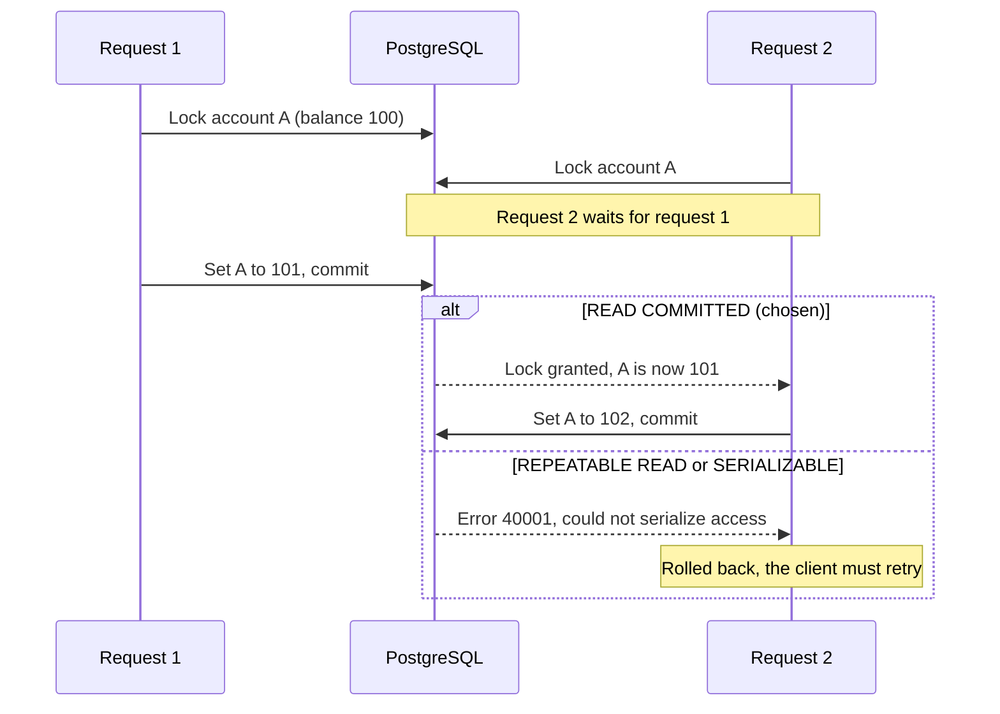

# 07. Isolation level READ COMMITTED

- **Status:** Accepted. Pinning the level in code is still to do.
- **Type:** Technical
- **Requirements:** [FR-5](../requirements.md#fr-5-safe-under-concurrent-requests), [FR-6](../requirements.md#fr-6-safe-retries-idempotency)

## Context

PostgreSQL offers `READ COMMITTED` (its default), `REPEATABLE READ`, and `SERIALIZABLE`. The row
locks of [decision 06](06-consistency-under-concurrent-requests.md) work differently at each
level.

## Decision

Use **`READ COMMITTED`**, together with the row locks.

## Why

- Every rule an operation checks is about a row it holds locked: the source balance and the target
  balance. A locked row cannot change under the operation, so lost updates and overdrafts cannot
  happen.
- A request that waited for a lock continues with the newest committed version of the row.
- Every statement sees the data committed before it started. A retry that waited for the first
  request therefore finds the transaction that request stored
  ([FR-6](../requirements.md#fr-6-safe-retries-idempotency), item 4).

### Why not a stricter level

At `REPEATABLE READ` and `SERIALIZABLE`, a database transaction keeps the snapshot it started with.
If it waits for a row that another transaction then changes, PostgreSQL aborts it with error
`40001` (`could not serialize access`) instead of letting it continue. The data stays correct, but
the request fails and must be retried. The service maps that error to `503` with `Retry-After`, so
busy accounts would answer with many `503`s.

### What READ COMMITTED allows, and why it does not reach users

`READ COMMITTED` prevents dirty reads, but it allows five other anomalies, and deadlocks are
possible at every level. Each one, checked against this service's four operations (open an
account, read an account, deposit, transfer):

| Anomaly | What it means | Here | Why |
|---|---|---|---|
| Lost update | A transaction writes back a value based on a stale read, overwriting another one's change | Cannot happen | Deposits and transfers read balances with `SELECT ... FOR UPDATE` and keep the lock until commit, across both the read and the write. |
| Write skew | Two transactions check a shared condition, then each changes a different row, and together they break the condition | Cannot happen today | Every rule is about a row the operation has locked (enough money, under the limit) or about data that never changes (currency, same account). The one shared condition, "this idempotency key is unused", is guarded by the unique column: the second insert fails, and that client gets `409`. |
| Nonrepeatable read | Reading a row again shows a newer committed value | No effect | No operation reads the same unlocked row twice. The idempotency lookup does see newer commits, and relies on it: a waiting retry finds the first request's transaction. |
| Phantom read | A repeated query returns a different set of rows | No effect | No operation repeats a query and acts on the result. The closest case, the idempotency key, is caught by the unique column. |
| Read skew | Related values are read at different moments and combined | Cannot happen | A transfer reads its two balances in two statements, but each under a lock held until commit, so both stay current. `GET /accounts/{accountId}` is one statement. |
| Deadlock | Transactions wait for each other in a cycle | Cannot happen | The fixed lock order rules out the opposite-order cycle ([decision 06](06-consistency-under-concurrent-requests.md)). A deposit locks one row. The foreign-key checks when a transaction is stored only touch accounts the operation already holds. |

## Consequences

- **The level is not pinned in code.** The service relies on the database default. A server
  configured with `default_transaction_isolation = serializable` would switch to the failing
  behavior above. The next step is `@Transactional(isolation = Isolation.READ_COMMITTED)` on the
  write operations.
- A future rule that spans rows nobody locks needs a guarding lock, or `SERIALIZABLE` with retries
  (see below).

### What users can notice

None of the anomalies above gives a user wrong data. These effects are visible, though:

- **Waiting on busy accounts.** Requests on the same account run one at a time. That shows up as
  latency, not as wrong balances.
- **`409 IDEMPOTENCY_KEY_CONFLICT`** when two requests use one key on different accounts at the same
  moment. That is client misuse, it is part of
  [FR-6](../requirements.md#fr-6-safe-retries-idempotency), and no money moves twice.
- **Read skew between separate API calls.** A client that fetches account A and then account B with
  two `GET` requests can see A after a transfer and B before it: a total that never existed. The two
  reads are separate database transactions, so no isolation level can prevent this. The fix is an
  endpoint that reads both in one `REPEATABLE READ` transaction (see below).

### When to revisit

- **A rule that spans rows nobody locks** (write skew), such as "a customer's accounts together stay
  above X" or "a daily limit is the sum of today's transfers". Either lock one row that guards the
  rule, such as the account or customer row, and keep `READ COMMITTED`. Or run those operations at
  `SERIALIZABLE` and add a retry loop for error `40001`.
- **Reads that span several statements and must agree** (read skew), such as a future account
  statement that reads the balance and a page of transactions, or an endpoint that returns several
  accounts. Run them read-only at `REPEATABLE READ` to get one snapshot. Read-only transactions never
  fail with serialization errors there. Today's `GET /accounts/{accountId}` is a single query, so
  `READ COMMITTED` is already consistent for it.
- **A new operation that locks several accounts** (deadlock). It must lock them in the same fixed
  order as transfers, or the opposite-order deadlock comes back.

## Alternatives considered

`REPEATABLE READ` and `SERIALIZABLE`, as above.

## Evidence

Measured on 2026-11-03 with a multi-threaded test against PostgreSQL (since removed from the
suite), with the connection pool forced to each level through
`SPRING_DATASOURCE_HIKARI_TRANSACTIONISOLATION`:

| Level | Concurrency checks | What happened |
|---|---|---|
| `READ COMMITTED` (chosen) | 4 of 4 pass | Requests on the same account wait for the lock, then continue |
| `REPEATABLE READ` | 0 of 4 pass | 705 `could not serialize access` errors in the test output |
| `SERIALIZABLE` | 0 of 4 pass | 702 `could not serialize access` errors in the test output |
