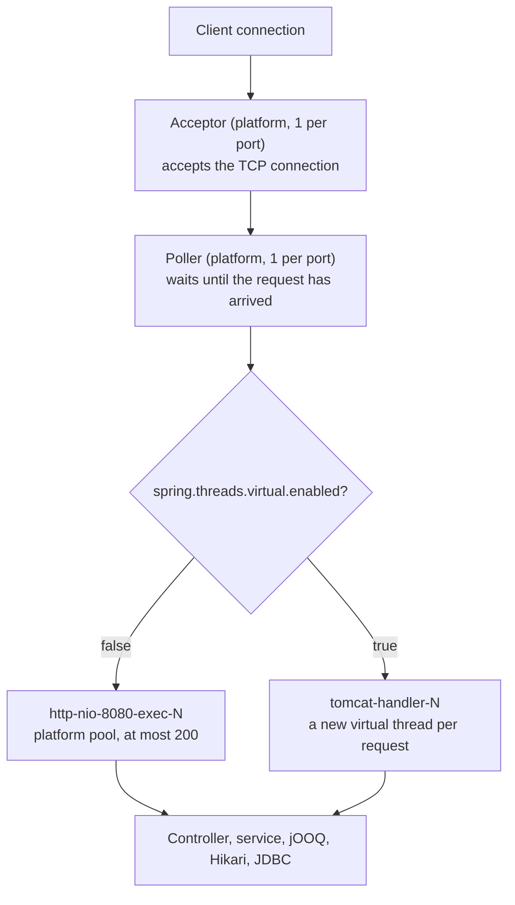
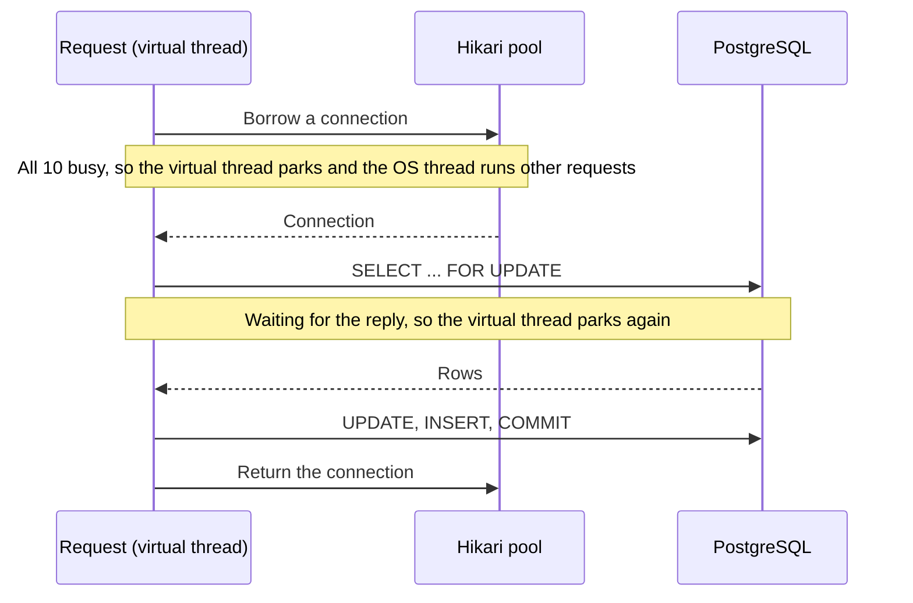

# 16. Virtual threads not enabled

- **Status:** Accepted
- **Type:** Technical
- **Requirements:** [FR-5](../requirements.md#fr-5-safe-under-concurrent-requests), and the brief's "could realistically run in production"

## Context

Java 21 and later offer virtual threads, and Spring Boot 3.2 and later can run every request on one
with a single setting. The service runs on Spring Boot's defaults:

- Tomcat handles requests on a pool of **platform threads** (10 kept warm, at most 200).
- HikariCP keeps at most **10 database connections**.
- Stack: Java 25, Spring Boot 4.1, HikariCP 7.0.2, PostgreSQL JDBC driver 42.7.14.

Every request is a short database transaction: borrow a connection, lock rows, write, commit
([decision 06](06-consistency-under-concurrent-requests.md)).

## Decision

**Keep platform threads.** `spring.threads.virtual.enabled` stays `false`.

Enable virtual threads when requests start waiting on something that does not hold a database
connection, such as slow HTTP calls to a payout provider, and enable them together with an
explicit concurrency limit.

## Why

**1. They would not raise throughput.** The limit is the 10 connections, not the threads. With
500 transfers at once:

```
Platform threads (today)             Virtual threads
200 get a thread, 300 wait           500 get a virtual thread
 └─ 10 get a DB connection            └─ 10 get a DB connection, 490 wait cheaply
Throughput: the same. Requests on one account still wait for its row lock.
```

**2. They move the backpressure.** Tomcat's 200 threads naturally limit how much work is in
flight. With virtual threads, `server.tomcat.threads.max` no longer applies. The cap becomes
`server.tomcat.max-connections` (8192) and `server.tomcat.accept-count` (100). Under overload,
thousands of requests would wait for the 10 connections until Hikari's 30-second timeout, then
fail with `503`. An explicit limit would be needed: a shorter `connectionTimeout`, or a cap on
concurrent requests.

**3. Raising the pool size is not the answer.**

- Each PostgreSQL connection is a separate server process. The default `max_connections` is 100,
  and several app instances share it.
- The database has a fixed number of cores. Past roughly `cores × 2 + disks` connections
  (HikariCP's sizing guide), more connections only make every query slower.
- Busy accounts still go one at a time: more connections just means more of them waiting on the
  same row lock.
- Better: a small pool, cheap waiting in the app, timeouts (`connectionTimeout`, `lock_timeout`,
  `statement_timeout`), and PgBouncer in front of PostgreSQL when many instances share it. Watch
  `hikaricp_connections_pending` to size the pool.

## Consequences

- Tomcat's 200 platform threads stay the limit on work in flight. No extra concurrency limit is
  needed today.
- Each waiting request holds an OS thread. That is fine at 200, and it is the cost being accepted.
- Sizing the pool still needs load tests, which are
  [out of scope](../requirements.md#out-of-scope) for this version.

### When to revisit

- **Requests wait outside the database,** such as HTTP calls to another service. Then threads,
  not connections, become the limit, and virtual threads make that waiting cheap.
- Enable them together with a shorter Hikari `connectionTimeout` or a cap on concurrent requests,
  so overload fails fast instead of queueing thousands of requests.

### How to enable them

One line:

```yaml
spring:
  threads:
    virtual:
      enabled: true
```

What it changes is listed under [Evidence](#evidence). The request path:



### JDBC under virtual threads

JDBC has no threads of its own. It runs on whatever thread calls it. On a virtual thread, the
whole chain (jOOQ, Hikari, the PostgreSQL driver) runs on that virtual thread, with no extra
setting. Every wait parks the virtual thread and frees its OS thread:



**Hikari vs JDBC:** JDBC is Java's standard database API, plus a driver per database (pgjdbc
here) that opens connections and runs SQL. HikariCP is a pool on top of it. It keeps connections
open, lends them out, and makes callers wait when all are busy. Its `close()` returns a connection
to the pool instead of closing it.

### Thread pinning

A virtual thread runs on a **carrier** OS thread, one per CPU core by default. **Pinning** means
it cannot unmount while it waits, so its carrier blocks too. A few pinned threads can stall
thousands of others.

| Cause | Java 21 to 23 | Java 24 and later (we use 25) |
|---|---|---|
| Blocking inside `synchronized` | Pins | Fixed (JEP 491) |
| `Object.wait()` inside `synchronized` | Pins | Fixed (JEP 491) |
| Blocking with a native frame on the stack | Pins | Still pins |
| Blocking inside a class initializer | Pins | Still pins |
| File I/O, some DNS lookups | The JVM temporarily adds a carrier | Same |

- Detect it with the JFR event `jdk.VirtualThreadPinned`.
- The PostgreSQL driver replaced `synchronized` with `ReentrantLock` in 42.6 for this reason, and
  HikariCP did the same. Our request path does not pin.

## Alternatives considered

- **Enable virtual threads now:** same throughput, and it removes the natural backpressure (see
  above).
- **A bigger connection pool:** more database processes and slower queries, and busy accounts
  still go one at a time (see above).
- **Reactive (WebFlux and R2DBC), Kotlin coroutines, or another runtime such as Node.js:** all
  make waiting cheaper in the app, but none adds database capacity.

| | Waiting for I/O | Database concurrency | Code style |
|---|---|---|---|
| Java, platform threads (chosen) | The OS thread blocks | Hikari, 10 connections | Plain blocking code |
| Java, virtual threads | Parks and frees the OS thread | Hikari, 10 connections | Plain blocking code |
| Java, reactive (WebFlux and R2DBC) | Event loop | R2DBC pool | `Mono` and `Flux` chains |
| Kotlin coroutines | Suspends at `suspend` calls only | Same pool | `suspend` everywhere. Blocking JDBC needs `Dispatchers.IO`. |
| Node.js | Event loop | `pg` pool, 10 connections by default | `async` and `await` |

- **Kotlin coroutines** are stackless: the compiler turns `suspend` functions into state machines.
  Virtual threads are stackful: the JVM saves the whole call stack. Coroutines have mature
  structured concurrency and cancellation. Java's `StructuredTaskScope` is still a preview in
  Java 25.
- **Node.js** has the same database limits. Waiting queues as pending Promises in the pool, and
  `node-postgres` waits forever for a connection unless `connectionTimeoutMillis` is set.

## Evidence

Thread names checked against the running Docker stack, with the setting off and on:

| | Off (chosen) | On |
|---|---|---|
| Thread that runs a request | `http-nio-8080-exec-1` (platform) | `tomcat-handler-0` (**virtual**) |
| Request worker pools | `http-nio-8080-exec-N` and `http-nio-9090-exec-N`, platform, up to 200 each | **Gone.** A new virtual thread per request, on the management port too. |
| Tomcat `Acceptor` and `Poller` | 1 per port, platform | 1 per port, **still platform** |
| JDK `MasterPoller` | — | New. The JDK's thread that watches sockets for parked virtual threads. |
| Spring `@Async`, `@Scheduled` | Platform thread pools | Virtual threads. This service uses neither. |
