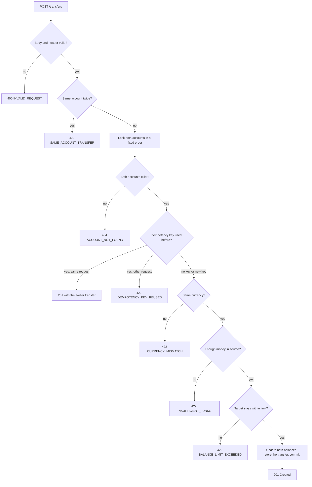

# Bank Account API: requirements

What the service does, as rules you can test. How it is built is in
[architecture.md](architecture.md), and why it works this way is in the
[decision records](decisions/README.md). The exact HTTP contract is the OpenAPI file
[`api.yml`](../src/main/resources/static/api.yml), which the running service serves at `/api.yml`.

Requirement IDs (`FR-n`) and question IDs (`Q-n`) stay stable, so tests, reviews, and discussions
can point at them.

## What clients can do

A client can:

1. Open an account for an owner in one currency, with or without money in it.
2. Read an account and its current balance.
3. Deposit money into an account.
4. Transfer money between two accounts, in one step that either fully happens or does not happen at all.
5. Retry a deposit or transfer safely, without moving money twice.

This version has no logins. Anyone who can reach the API can use every operation
([decision 05](decisions/05-no-authentication.md)).

## Terms

| Term | Meaning |
|---|---|
| **Account** | Holds money for one owner in one currency. Its currency never changes. |
| **Owner name** | The account holder's name, given when the account is opened. |
| **Currency** | An ISO 4217 code, such as `EUR`. |
| **Minor unit** | The smallest unit of a currency: cents for EUR, yen for JPY (which has no decimals). |
| **Amount** | A whole number of minor units. For EUR, `1050` means €10.50. |
| **Balance** | The money in an account, in minor units. Never negative. |
| **Transaction** | A stored record of one deposit or one transfer. Never changed after it is stored. |
| **Deposit** | A transaction that adds money to one account, the *target*. It has no source account. |
| **Transfer** | A transaction that moves money from a *source* account to a different *target* account. |
| **Opening deposit** | The deposit stored when an account opens with a positive initial balance. |
| **Ledger** | All transactions together. For every account, the ledger explains the balance: money in minus money out. |
| **Idempotency key** | A string the client chooses and sends in the `Idempotency-Key` header, so a retried request is applied only once. |
| **Replay** | Answering a retried request with the transaction that the first request stored. |

An account has many transactions. A deposit points at one account. A transfer points at two
different accounts that use the same currency. Where each term lives in the code, the API, and the
tables is in [architecture.md](architecture.md#where-each-term-lives).

## Functional requirements

### FR-1 Open an account

`POST /accounts`

1. The client gives an owner name, a currency, and an optional initial balance.
   - `ownerName`: required, not blank, at most 100 characters as sent. Spaces at the start and end are then removed before the name is stored.
   - `currency`: required. An uppercase ISO 4217 code with a defined number of decimal places, such as `EUR` (2) or `JPY` (0). Codes without one, such as `XAU` (gold) or `XXX`, are rejected.
   - `initialBalance`: optional. Missing or `null` means `0`. Must be `0` or more.
2. The service creates the account with a new random ID. It answers `201 Created`, with a `Location`
   header that points at the new account.
3. A positive initial balance is stored as an opening deposit, so the ledger explains every balance.
   An initial balance of `0` stores no transaction.

### FR-2 Read an account

`GET /accounts/{accountId}`

1. Returns the account with its current balance.
2. Unknown ID: `404`. An ID that is not a UUID: `400`.

### FR-3 Deposit money

`POST /accounts/{accountId}/deposits`

1. `amount` is required and must be `> 0`. It is always in the account's currency.
2. The balance increases by `amount`, and one deposit is stored, in one database transaction.
3. Returns the deposit with `201 Created`.
4. Unknown account: `404`. A balance that would go past the largest storable value
   (`9223372036854775807` minor units): `422`.
5. Checks run in this order: the account exists, then the idempotency key ([FR-6](#fr-6-safe-retries-idempotency)),
   then the balance limit.

### FR-4 Transfer money

`POST /transfers`

1. `sourceAccountId`, `targetAccountId`, and `amount` (`> 0`) are required.
2. **Atomic:** the source balance goes down, the target balance goes up, and one transfer is
   stored. Either all three happen or none of them do.
3. Checks run in this order. The first check that fails decides the response.
   1. Source and target must be different accounts, else `422`. This check runs before the accounts are looked up.
   2. Both accounts must exist, else `404`.
   3. If the request carries an idempotency key that was used before, [FR-6](#fr-6-safe-retries-idempotency) decides the response. No further checks run.
   4. Both accounts must use the same currency. There is no currency exchange. Else `422`.
   5. The source must have at least `amount`. Overdrafts are not allowed. Else `422`.
   6. The target balance must not go past the largest storable value, else `422`.
4. Returns the transfer with `201 Created`. Its currency is the currency of both accounts.



How transfers stay atomic and correct under load is in
[decision 06](decisions/06-consistency-under-concurrent-requests.md).

### FR-5 Safe under concurrent requests

1. Concurrent deposits and transfers never lose an update. The final balances equal the result of
   running the same operations one after another.
2. No balance ever goes below zero, even when many transfers drain the same account at once.
3. Two transfers in opposite directions (A to B and B to A) at the same time never deadlock.
4. After any mix of operations, every balance equals its incoming minus outgoing ledger amounts.

How: [decision 06](decisions/06-consistency-under-concurrent-requests.md) and
[decision 07](decisions/07-isolation-level-read-committed.md).

### FR-6 Safe retries (idempotency)

Networks fail. A client that gets no response does not know whether money moved. Deposits and
transfers therefore accept an optional `Idempotency-Key` header with 1 to 255 characters.

1. First request with a key: processed normally, and the key is stored with the transaction.
2. Same key and the same request again: returns the original transaction with `201`. No money moves again.
3. Same key with a different request (other accounts, amount, or operation): `422`.
4. Same key sent again while the first request is still running: the retry waits for the first one
   and then returns its result. In the rare case where the two requests touch different accounts,
   the second one gets `409` and can retry.
5. Only successful requests are remembered. A request that failed (for example, not enough money)
   can be retried with the same key.
6. Keys are global, because the API has no clients or logins yet, and are kept forever.
7. "The same request" means the same operation, the same accounts, and the same amount.
8. A replay ignores what happened since. For example, it returns the original transfer even if the
   source account is now empty.
9. An empty header value is invalid: `400`. Account opening does not use idempotency keys.

How: [decision 04](decisions/04-idempotent-retries.md).

## API rules

These rules apply to every endpoint. The endpoints, fields, and types themselves are in
[`api.yml`](../src/main/resources/static/api.yml).

- Request bodies must be `application/json`. Anything else gets `415`.
- Successful responses are `application/json`. Errors are `application/problem+json`. A client
  that accepts neither gets `406`.
- IDs are UUID strings.
- Timestamps are ISO 8601 in UTC, with up to microsecond precision, for example
  `2026-11-02T20:20:53.987861Z`.
- `amount` and `initialBalance` are JSON whole numbers. A decimal such as `10.5` gets `400` and is
  never rounded. A value outside the 64-bit signed range gets `400`.
- Unknown body fields are ignored ([Q-1](#open-questions)). A whole number sent as a string, such as
  `"100"`, is accepted ([Q-2](#open-questions)).
- Header names are case-insensitive, as in all of HTTP.
- Another HTTP method on a known path gets `405`. An unknown path gets `404` with code `NOT_FOUND`.
- The stored idempotency key is never returned.
- Deposits and transfers return no `Location` header, because there is no endpoint to read a single
  transaction yet ([decision 09](decisions/09-api-design.md)).

### Error responses

Every error uses the [RFC 9457](https://www.rfc-editor.org/rfc/rfc9457) problem format with an
extra `code` field ([decision 08](decisions/08-error-responses.md)):

| Field | Meaning |
|---|---|
| `title` | Short summary, such as `Insufficient funds` |
| `status` | The HTTP status code |
| `detail` | Plain-language explanation. May contain account IDs or the idempotency key. Never contains internal details. |
| `instance` | The request path |
| `code` | Machine-readable code from the table below. Clients should branch on this field. |
| `errors` | Only for invalid fields or headers: a list of `{"field", "message"}`. `field` is a body field name or a header name such as `Idempotency-Key`. |

`type` is left out, which means `about:blank`. A body that cannot be read at all (bad JSON, a
decimal amount) gets `400` without an `errors` list.

A broken business rule:

```json
{
  "title": "Insufficient funds",
  "status": 422,
  "detail": "Account 01dfe2bd-... does not have enough money for this transfer.",
  "instance": "/transfers",
  "code": "INSUFFICIENT_FUNDS"
}
```

An invalid field:

```json
{
  "title": "Bad Request",
  "status": 400,
  "detail": "The request has invalid fields.",
  "instance": "/transfers",
  "code": "INVALID_REQUEST",
  "errors": [{"field": "amount", "message": "must be greater than or equal to 1"}]
}
```

**Choosing the status:** `400` means the request is wrong on its own. `422` means the request is
well formed but breaks a business rule. `404` and `409` keep their usual HTTP meaning.

| Status | `code` | When |
|---|---|---|
| 400 | `INVALID_REQUEST` | Bad JSON, a missing or invalid field, a decimal amount, a bad UUID, or a bad header |
| 404 | `ACCOUNT_NOT_FOUND` | An account in the path or body does not exist |
| 404 | `NOT_FOUND` | The path does not exist |
| 405 | `METHOD_NOT_ALLOWED` | The path exists, but not for this HTTP method |
| 406 | `NOT_ACCEPTABLE` | The client accepts neither JSON nor problem JSON |
| 409 | `IDEMPOTENCY_KEY_CONFLICT` | Another request with the same key finished first, on different accounts |
| 415 | `UNSUPPORTED_MEDIA_TYPE` | The body is not `application/json` |
| 422 | `SAME_ACCOUNT_TRANSFER` | Source and target are the same account |
| 422 | `CURRENCY_MISMATCH` | Source and target use different currencies |
| 422 | `INSUFFICIENT_FUNDS` | The source balance is lower than the amount |
| 422 | `BALANCE_LIMIT_EXCEEDED` | The balance would go past the largest storable value |
| 422 | `IDEMPOTENCY_KEY_REUSED` | The key was already used for a different request |
| 503 | `SERVICE_UNAVAILABLE` | The database is unreachable or busy. Sent with `Retry-After: 1`. Reads are safe to retry. Deposits and transfers are safe to retry with the same `Idempotency-Key`, because a failed commit can leave the outcome unknown. |
| 500 | `INTERNAL_ERROR` | Anything unexpected. The response gives no internal details. The log has them. |

Other errors that the web framework raises use the HTTP status name as their `code`.

## Out of scope

Deliberate cuts to fit the time box. Each is a natural next step.

- Authentication, authorization, and account ownership, for example as an OAuth2 resource server.
- Withdrawals, closing accounts, fees, limits, and currency exchange.
- Listing accounts, reading a single transaction, and an account statement (ledger history) with
  cursor pagination. The indexes for the statement already exist.
- Idempotent account opening, idempotency keys scoped per client, and expiry of old keys.
- A client library generated from `api.yml`.
- Business metrics (transfers, failures by `code`) and tracing with OpenTelemetry.
- Load tests to size the connection pool, time-ordered IDs (UUIDv7), and a plan for very busy accounts.
- Publishing "transfer completed" events through a transactional outbox.
- Rate limiting, an audit of who made each change, and multi-region deployment.

## Open questions

The code behaves this way today, but nobody decided it on purpose. Each needs a decision.

| ID | Current behavior | Options |
|---|---|---|
| Q-1 | Unknown body fields are ignored. `{"amount": 1, "amout": 5}` deposits 1. | Keep it: tolerant of newer clients. Or reject with `400`: catches client typos. |
| Q-2 | A whole number sent as a string is accepted. `{"initialBalance": "100"}` opens the account with 100. | Keep it: lenient. Or reject with `400`: a stricter contract. |
